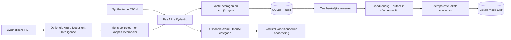
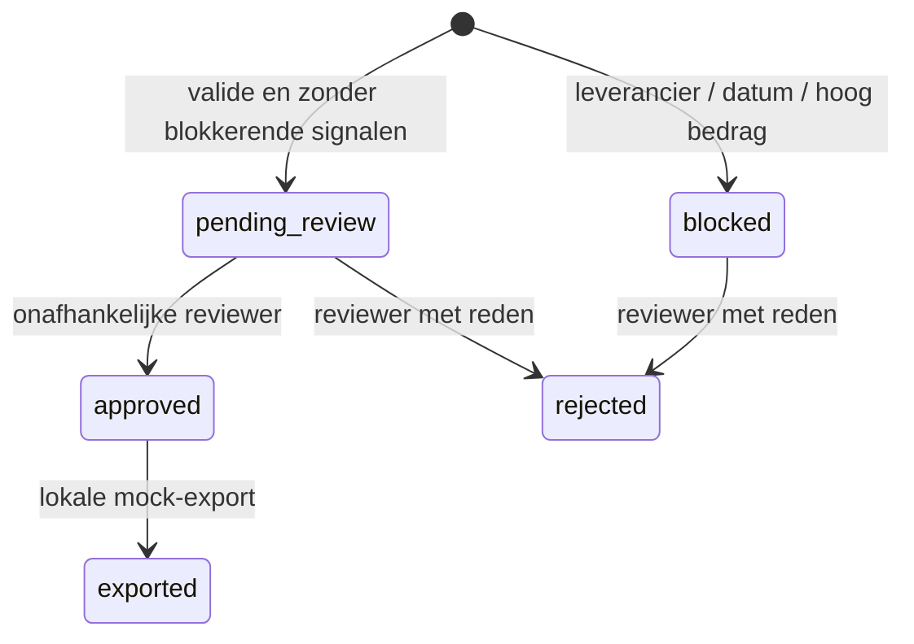

# Architectuur en technische afwegingen

## Invarianten

1. Een factuur mag pas exporteren na een geldige menselijke goedkeuring.
2. Operator en reviewer hebben verschillende serverbepaalde actoren; de client kan actor/tenant/rol niet in de factuur kiezen.
3. Elke factuur heeft maximaal één outbox-item en één lokale mockboeking.
4. Een gewijzigde body met dezelfde idempotency-sleutel is een conflict, geen update.
5. Een tenant kan geen factuurdetails of audit van een andere tenant lezen.
6. Modeluitvoer wijzigt geen factuurstatus; uitsluitend de deterministische reviewroute kan dat.

## Statusovergangen

`blocked` kan niet worden overruled. High-value is hier een conservatieve grens van EUR 10.000, geen Belgische wettelijke norm. Een echte organisatie moet een tweede goedkeuringsniveau en correctie/revisieproces ontwerpen. Afgewezen/uitgevoerde facturen zijn in dit prototype immutable via de API.

## ADR 001 — SQLite voor reproduceerbaar bewijs

SQLite verlaagt de instap en maakt transacties, herstel en concurrency-tests reproduceerbaar. `BEGIN IMMEDIATE` serialiseert ook reads; dit is bewust eenvoudig en beperkt throughput. Voor meerdere instances: PostgreSQL met migraties, row locking, een aparte queue en geteste recovery. Kopieer het SQLite-bestand niet willekeurig tijdens writes; zie runbook.

## ADR 002 — AI buiten de autorisatiegrens

OCR en categorisatie zijn onafhankelijke voorstellen. Vrije tekst is onbetrouwbaar, ook na extractie. Een JSON-schema beperkt de structuur, maar garandeert geen inhoudelijke juistheid. Geen model krijgt credentials van de exporter of een betaaltool. Een geslaagde prompt injection kan daardoor geen boeking uitvoeren.

## ADR 003 — transactionele outbox, begrensde claim

Goedkeuring en outbox schrijven atomair. De lokale mock-consumer schrijft boeking en acknowledgement in dezelfde database-transactie. Daarom kan die mock binnen deze database precies eenmaal worden geboekt. Bij een echte ERP bestaan twee transactiedomeinen: gebruik het stabiele outbox-id als ERP-idempotency key, plus statusreconciliatie en dead-letterbeleid. Claim daar geen exactly-once zonder contract met de ERP.

## ADR 004 — Microsoft-first pilotpad

Lokale API → Entra ID-protected App Service/Container Apps → Azure PostgreSQL → Azure Service Bus → ERP-adapter, met Key Vault/managed identities en Application Insights. DI/Azure OpenAI-adapters zijn aanwezige code; deze infrastructuur is een ontwerp, geen uitgerolde omgeving. Foundry-hosted agents zijn voor dit deterministische kernproces niet vereist. Gebruik de Microsoft Foundry-skill voordat je later Foundry-agents toevoegt of beheert.
